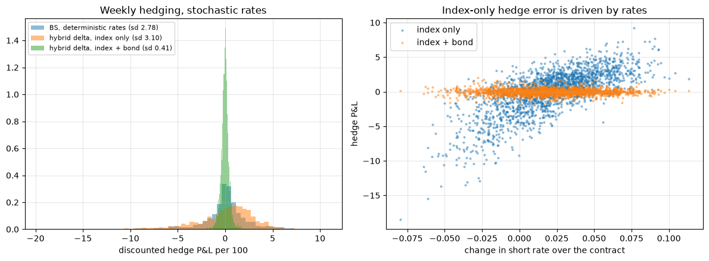

# guarantee-hedging-sim

An insurer that hedges a 10-year variable annuity guarantee with only the stock index, while interest rates move, is left with a hedge error whose standard deviation is 3.10 per 100 of premium. Adding one zero-coupon bond that matures with the guarantee brings that down to 0.41, about 7.5 times lower. That is the headline of this project, a Monte Carlo study of how much a guaranteed minimum maturity benefit (GMMB) on a segregated fund or variable annuity is worth, and how well it can be hedged. Rates matter for the price as well: with a Hull-White model fitted to the U.S. Treasury curve, assuming fixed rates undervalues a 20-year guarantee by 22%.



Weekly hedging of a 10-year guarantee over 2,000 simulated paths. On the right, the index-only hedge error lines up with the change in the short rate, and the bond takes it out. This is section 9 of the report ([`docs/report.html`](docs/report.html)).

## How it works

The guarantee pays at least `G` at maturity whatever the fund is worth, so the insurer is short a put on the policyholder's fund. I started with the simple version: Black-Scholes with one flat rate, Monte Carlo pricing with antithetic and control variates (together they cut variance per path by a factor of 10.5), checked against the closed form across guarantee levels and maturities. On top of that sits a backtester that delta hedges on a simulated grid, pays proportional transaction costs and reports the spread of hedge P&L along with VaR and CVaR. Daily rebalancing gives about 4.4 times less error than monthly, close to the square root of 21 that theory predicts.

Heston was harder. A Heston hedge backtest has to reprice the guarantee at thousands of (index, variance) states on every rebalancing date, and pricing them one by one was far too slow. What made it feasible was putting the Fourier integral on a quadrature grid that depends only on time to maturity, so a whole date prices in one matrix product. The result surprised me. Hedging with the true Heston delta did worse than Black-Scholes at the implied volatility, because delta hedging alone can't remove variance risk, whatever the model. The historical backtest on S&P 500 data was humbling in a similar way: rebalancing more often didn't reduce the error, since it's driven by the gap between realised volatility and the volatility assumed at issue.

The stochastic-rate part bootstraps a zero curve from Treasury par yields, fits one-factor Hull-White to it exactly and takes the other two parameters from historical yield volatility. Bond and bond-option prices are checked against closed forms, including Jamshidian's formula for coupon bonds. The guarantee is then priced in a hybrid model (GBM index, correlated Hull-White rates) by Monte Carlo and in closed form, and hedged with the index plus the bond.

Most results have a test behind them with a fixed seed, usually asserting agreement with a closed form within 3 standard errors.

## Running it

Python 3.10 or newer.

```bash
python3 -m pip install -r requirements.txt                                        # or: pip install -e ".[test,notebook]"
python3 -m pytest -q                                                              # 136 tests, including the statistical checks
jupyter nbconvert --to html --execute notebooks/report.ipynb --output-dir /tmp    # the full report with charts and tables
```

Tests and the notebook read the committed FRED snapshots in `data/`, so they run offline. The full write-up is [`notebooks/report.ipynb`](notebooks/report.ipynb). A minimal price check from Python:

```python
from ghedge import GBM, GMMBContract
from ghedge import blackscholes as bs
from ghedge.montecarlo import price_gmmb

c = GMMBContract(guarantee=100, maturity=10, fee=0.02, rate=0.03)
print(bs.gmmb_value(c, 0.2))                                    # closed form
res = price_gmmb(c, GBM(0.2), 200_000, "antithetic_control", rng=1)
print(res.estimate, res.std_error, res.ci())
```

More examples (hedging, Heston, Hull-White, the hybrid model) are in [docs/usage.md](docs/usage.md).
Model assumptions and methods are in [docs/models.md](docs/models.md).
Every result with its setup is in [docs/results.md](docs/results.md).
What the test suite checks is in [docs/tests.md](docs/tests.md).
Data sources and how to refresh them are in [docs/data.md](docs/data.md).

## Known gaps

- Lapses and mortality are deterministic and independent of the market. No moneyness-dependent lapses and no death benefit.
- Rates are one-factor, so the curve can't twist, and the Hull-White parameters come from historical yields rather than swaption prices. Rates can also go negative. Putting Heston and Hull-White together in one hybrid is the obvious next step.
- There is no vega hedge with options, so Heston variance risk stays open, and the Heston hedger is handed the true variance and parameters instead of calibrating them.
- The historical backtest uses a price index without dividends, a flat 2% rate and about ten years of FRED data, with heavily overlapping windows, so it shouldn't be read as more than a sanity check.

Project period: 2026-01-12 to 2026-10-13.
